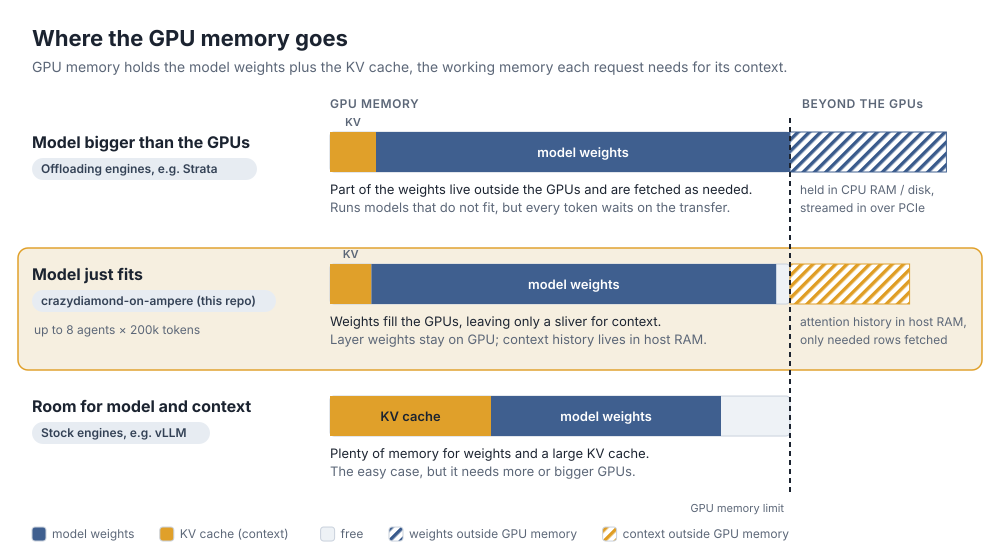
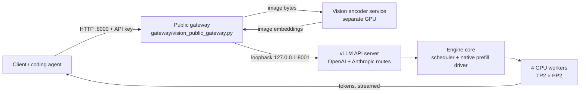
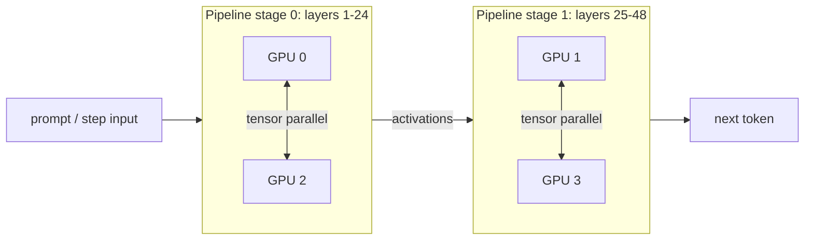

# crazydiamond-on-ampere

**Qwen3.8-Flash-Next (INT4 weights, Intel AutoRound W4A16) on four RTX 3090s: 8 agent sessions × 200,000 tokens of context, with the KV cache in host RAM.**

## Performance

Measured on our box (4 × RTX 3090) against stock vLLM with the same image, model, GPUs and limits. The stock arm runs vLLM's own QSA host-KV mode (`VLLM_QSA_KV_OFFLOAD=1`) and its launcher (`packet/run-flash-stock-keyed.sh`) also mounts our QSA row-cache files (`qsa.py`, `ops_qsa.py`). These comparisons therefore measure the rest of the overlay (the native prefill lane, the prefill/decode split and the scheduling), not host KV. **Build-6** is the release published here. **Predecessor** is build-6's direct predecessor with the same engine settings. Details and caveats are under [Results](#results).

| Metric | This engine | Stock vLLM | Conditions |
|---|---|---|---|
| **Agent turns per hour** | **1.11×** stock (interval 1.10–1.12) | 1.0 | Closed-loop replay of 8 live coding-agent sessions (predecessor, 262k context × 10 sequences) |
| **Concurrency** | **8 sessions × 200,000 tokens** | same limits | Build-6: 8 conversations at ≥ 196,850 tokens each, all at once; 0 out-of-memory errors, 0 preemptions |
| **Decode, live, 1 request** | **72.6 tok/s** (median; up to 79.5) | — | Production traffic, 1-minute rates from the engine's own metrics, 15–22 Nov (build-6 and its predecessor) |
| **Decode, live, 3–4 requests** | **58 tok/s** per request, **181 tok/s** total | — | same |
| **Decode, live, 8 requests** | **56 tok/s** per request, **443 tok/s** total (peak 471) | — | same; requests still in prefill count as running, so per-request figures are conservative |
| **Decode, controlled** | **78.4 tok/s** for 1 stream, **60.1 tok/s** per stream with 8 | not measured | Build-6 speed probe, short context |
| **Prefill, one turn alone** | **7,107–7,261 tok/s** at 150k (21 s), **6,779–6,909 tok/s** at 200k (29 s) | not measured | Build-6 + unused tables dropped (measured speed-neutral vs build-6) |
| **Prefill, fresh 190k beside 7 decoding streams** | **5,121 tok/s** (first token 37.1 s) | 4,121 tok/s (46.1 s) | Build-6 memory-fit run vs the matched stock run |
| **Prefill, 8 fresh 60k prompts at once (aggregate)** | **6,236 tok/s** | 4,943 tok/s | Predecessor, text (build-6 with one image per prompt: 5,237 tok/s) |
| **Short follow-up turn, time to first token** | **2.30 s** mean | 2.36 s | Appends of 0.5k–5k tokens on 60k–131k histories, live replay (predecessor) |

Where stock is faster: a fresh long prompt with nothing else queued (first of 8 simultaneous 60k prompts: 6,852 vs 7,168 tok/s), and the mean wait for a fresh turn in the live replay (51.7 s vs 40.1 s), because the engine serves returning agents' short turns ahead of bulk prefill. The engine wins on decode under load and on turns per hour.

Against [Strata](https://github.com/Niko1221/Strata) 0.2.20 on the same box and the same 8-agent replay: **1,005 vs 225 agent turns per hour** (285 in Strata's concurrent-prefill mode). Strata decodes a single request faster (83–96 vs 76–78 tok/s). See [Measured against Strata](#measured-against-strata-on-the-same-box).

Records: live decode from the engine's Prometheus metrics on the serving port (`vllm:generation_tokens_total`, `vllm:num_requests_running`), build-6 speed probe `fri20-n7/decide-m2.stdout` (`40fb56bb`), build-6 fit run `g4/arm-result.json` (`fe789e09`), matched stock fit `w23-fit-result.json` (`9ed2507f`), replay `cxfx42-read/cx.json` (`871227cb`) and `registered.txt` (`35bb6148`), solo prefill `m3a/decide.stdout` (`6b948c44`).

## What this is

This repository holds the working version of our inference engine for **Qwen3.8-Flash-Next**, a large mixture-of-experts language model, running on **four NVIDIA RTX 3090 cards** (Ampere generation, 24 GB each) split as **TP2 × PP2**: two pipeline stages of 24 layers each, and each stage a tensor-parallel pair of GPUs. A **fifth RTX 3090** runs the vision encoder for images. The engine is an **overlay on vLLM**: it keeps the stock vLLM container image and mounts its own Python modules and two small CUDA helpers over it. It serves up to **8 agent sessions at once, each with up to 200,000 tokens of context**. The release published here is **build-6**, our current stable release.

**Quantization.** The checkpoint is `Intel/Qwen3.8-Flash-Next-W4A16-AutoRound`: 4-bit integer weights made with AutoRound 0.15.0 (group size 128, symmetric, GPTQ packing), with the embeddings and a set of sensitive projections (2,340 per-layer overrides, e.g. the hyper-connections and the linear-attention `in_proj_a`/`in_proj_b`) kept in 16-bit. Activations run in BF16 (`--dtype bfloat16`) and the KV cache is BF16 (`--kv-cache-dtype auto`). The expert layers run on vLLM's Marlin INT4 kernels.

**The setting: the KV cache lives in host RAM.** The model's weights only just fit on the four 24 GB cards, which leaves almost no GPU memory for the KV cache, the per-conversation attention history that grows with every token of context. So the QSA layers' attention history lives in pinned host RAM, and each step reads only the rows that sparse attention selects over PCIe. **That mechanism is not ours.** vLLM ships it as an experimental QSA host-KV mode (`VLLM_QSA_KV_OFFLOAD=1`), and [Strata](https://github.com/Niko1221/Strata) does the same for this model in its own engine. What this repository adds is a VRAM cache for the hot rows and, above all, a different way to run prefill and decode side by side on four GPUs, so that 8 sessions × 200,000 tokens stay fast under load. See [Prior art and what is ours](#prior-art-and-what-is-ours).

## Our approach in one picture

<picture>
  <source media="(prefers-color-scheme: dark)" srcset="docs/img/approach-dark.svg">
  
</picture>

A model on GPUs needs memory for two things: its **weights** and its **KV cache**, the working memory that holds each request's context.

- **Offloading engines** run models that are *bigger* than your GPUs by keeping part of the weights in CPU RAM or on disk. Some also move the KV cache: [Strata](https://github.com/Niko1221/Strata), for example, offloads experts *and* keeps this model's QSA KV in host RAM, fetching only the selected blocks into a VRAM cache. The weight traffic costs time on every token.
- **Stock engines** (e.g. vLLM) are at their best when there's *room to spare* for weights and a large KV cache. That usually means more or bigger GPUs.
- **This engine** covers the case in between: the model *just fits* on four 24 GB RTX 3090s, leaving almost nothing for context. The layer weights stay on the GPUs; what moves is the *context*. The attention history and the large n-gram embedding tables live in host RAM. Decode fetches only the rows each step needs over PCIe; prefill streams the history over in bounded pieces. That lets the sliver serve up to 8 concurrent agents × 200k tokens. The host-KV part is vLLM's own; what we added is listed below.

## Prior art and what is ours

We did not invent the main mechanisms this engine relies on, and we should have said so from the start.

| Mechanism used here | Earlier or parallel work |
|---|---|
| QSA KV in pinned host RAM, read through a unified-address view; each step fetches only the indexer-selected rows; prefill history staged through an arena | **vLLM itself**: the pinned image's experimental QSA host-KV mode (`VLLM_QSA_KV_OFFLOAD=1`, `VLLM_QSA_KVO_ARENA`, the `_qsa_gather_selected_host_rows` kernel). **[Strata](https://github.com/Niko1221/Strata)** (MIT) shipped the same idea for Qwen3.8-Flash-Next in its own engine on 27 Sep 2026, with a VRAM cache of selected blocks and CLOCK eviction (`--kv-resident`). More general earlier work: [SGLang HiSparse](https://www.lmsys.org/blog/2026-04-10-sglang-hisparse) (2026), [InfLLM](https://arxiv.org/abs/2402.04617) (2024), [InfiniGen](https://usenix.org/conference/osdi24/presentation/lee) (OSDI 2024), [ShadowKV](https://arxiv.org/abs/2410.21465), [ArkVale](https://proceedings.neurips.cc/paper_files/paper/2024/file/cd4b49379efac6e84186a3ffce108c37-Paper-Conference.pdf). |
| A VRAM cache of recently selected rows | Strata's resident block cache and HiSparse's device buffer do the same job. Our implementation (the `_qsa_rowcache_*` kernels, a changed `_qsa_sparse_paged_gqa_splitk_kernel` that reads cached rows from VRAM and the rest from host memory, and five `_s6_*` index helpers in `ops_qsa.py`) was written for this overlay. |
| Prefill and decode at the same time on one GPU by splitting its SMs with CUDA green contexts | [Nexus](https://arxiv.org/abs/2507.06608) (2025, on vLLM) and [MuxWise / PD-Multiplexing](https://arxiv.org/abs/2504.14489) (2025, on SGLang). Related: [semi-PD](https://arxiv.org/abs/2504.19867) (MPS), [POD-Attention](https://arxiv.org/abs/2410.18038), [NanoFlow](https://arxiv.org/abs/2408.12757). |

What this repository adds is engineering, not a new idea:

- These mechanisms working together in a vLLM deployment on 4 × RTX 3090 (TP2 × PP2) with **all weights in VRAM**, aimed at **8 concurrent agent sessions × 200,000 tokens**.
- A native prefill lane: prefill chunks leave vLLM's scheduler step and run on private buffers and their own NCCL communicators while decode keeps stepping, with the two pipeline stages progressing independently.
- vLLM's decode CUDA graphs captured a second time inside the decode green context (the "split bank").
- Measurements against stock vLLM on the same box, under concurrent agent load.

Strata is built for a different case: one consumer GPU with expert offload, splitting by layer when it runs on several. To see how the two compare for our use, we ran it on our box with 8 slots; the results follow.

### Measured against Strata on the same box

On 24 Nov 2026 we ran [Strata](https://github.com/Niko1221/Strata) 0.2.20 (image `ghcr.io/niko1221/strata@sha256:ca619664…`, engine 0.1.66) on the same 4 × RTX 3090 box as build-6, with the same test client, prompts and agent replay. Strata ran Unsloth's `UD-IQ4_XS` GGUF of the same model across all four GPUs, with 8 slots, 200,000 tokens of context, fp16 KV, drafting off and images off, plus `--kv-resident 32768` (its VRAM cache of selected KV blocks) and `--ple-io ram`. "Piped" is Strata's `STRATA_PIPED_CONCURRENT=1` mode, which prefills beside running decodes.

**8 agents, closed-loop replay** (8 coding-agent sessions × 480 s, seed 1; each agent sends its next turn when its last one finishes):

| | Build-6 | Strata | Strata, piped |
|---|---|---|---|
| Agent turns per hour | **1,005** | 225 | 285 |
| Turns completed, whole run | **141** | 38 | 46 (+2 unfinished) |
| Output tokens/s, all agents | **163.4** | 34.3 | 45.3 |
| Decode tok/s per request, median | **35.7** | 8.2 | 26.5 |
| Follow-up turn, time to first token, median / p95 | **2.17 / 4.04 s** | 16.8 / 35.0 s | 46.2 / 156.8 s |
| Follow-up prompt tokens served from cache | **97 %** | 45 % | 50 % |
| New conversation, time to first token, median | **37.3 s** | 39.7 s | 54.1 s |

**One request alone** (512 output tokens forced; each engine counts prompt tokens with its own tokenizer):

| Prompt | Build-6 time to first token | Strata time to first token | Build-6 prefill | Strata prefill | Build-6 decode | Strata decode |
|---|---|---|---|---|---|---|
| ~50k | **7.0 s** | 8.8 s | **7,380 tok/s** | 5,554 tok/s | 77.5 tok/s | **91.3 tok/s** |
| ~100k | **13.8 s** | 15.1 s | **7,440** | 6,537 | 76.8 | **86.9** |
| ~150k | **21.3 s** | 24.3 s | **7,227** | 6,115 | 76.2 | **95.9** |
| ~200k | not run¹ | 29.8 s | not run¹ | 6,584 | not run¹ | 83.2 |

¹ Build-6's 200k test prompt plus 512 output tokens came to more than its 200,000-token limit, so the request was refused. An earlier build-6 run measured 29 s and 6,779–6,909 tok/s at 200k (see [Performance](#performance)).

**One fresh ~188k-token prompt beside 7 decoding conversations:**

- **Strata:** its 7 decoders ran at 48.9 tok/s each before the new prompt arrived and at **0.3 tok/s each while it was read** (piped mode: 49.4 → 12.9 tok/s). It read the new prompt at 7,239 tok/s, first token after 26.0 s (piped: 6,024 tok/s, 31.1 s).
- **Build-6** (an earlier run of the same shape, not from this session): it read a fresh 190k prompt at 5,121 tok/s, first token after 37.1 s. Its 7 companions averaged 36.5–37.1 tok/s over their whole 221–224 s decode, a window that contains that 37 s prefill. That run did not record a separate rate for the prefill window itself.

**Where the gap comes from.** Prefill speed is not it: beside 7 running conversations, Strata read a fresh prompt faster than build-6 (7,239 vs 5,121 tok/s), by pausing the other seven. Two other things add up:

1. **Strata re-reads much of each conversation.** It sized its conversation cache from free RAM at 8 GiB "for up to 4 parked conversations", and one parked 120k–130k-token conversation took 6–7.5 GB of it. With 8 agents taking turns, only about half of the follow-up prompt tokens came from that cache, and the rest of each history had to be read again. Build-6 keeps every conversation's history in host RAM and served 97 % of follow-up prompt tokens from it.
2. **In its default mode, Strata stops decoding while it reads a prompt.** Each of those re-reads froze the other agents, and because every agent waits for its reply before sending its next turn, the freezes queued up. Build-6 keeps decoding while it prefills, through the native prefill lane and the green-context split described above.

**Where Strata is ahead:** single-request decode, 83–96 vs 76–78 tok/s. With drafting off, Strata still guesses ahead from text already in the conversation (prompt lookup, `--spec 4`); we did not measure how much of its lead that accounts for. Build-6 has no speculative decoding yet (see [Status and limitations](#status-and-limitations)).

**Caveats:**

- **Different quantizations of the same model:** Unsloth `UD-IQ4_XS` GGUF for Strata, Intel AutoRound W4A16 for build-6. We did not check output quality on either engine in this comparison.
- **Strata ran close to its defaults.** We did not run its autotuner or enlarge its conversation cache (`--conversation-cache-mib`). A larger cache would raise its hit rate; we have not measured by how much.
- **Two workarounds for our box.** Strata 0.2.20 fails on RTX 30-series cards in its Q8 hyper-connection kernels (a known bug, Strata #6713; the fix is due in 0.2.21), so we ran it with the workaround that its maintainer tested, `STRATA_HC_Q8_TC=0 STRATA_HC_Q8_BF16TC=0`. Our container also cannot lock memory, which Strata documents as costing up to 6 % decode speed for its n-gram table.
- **Output lengths** were forced to the recorded turn lengths: with `min_tokens` on build-6 and an end-of-sequence logit bias on Strata.
- **One run of each** (seed 1), no repeats.

Record: comparison report `strata-cmp-20261124/REPORT.md` (`b671dd4c`).

## How it works

### A few words first

| Term | Meaning here |
|---|---|
| **VRAM** | The memory on a GPU card (24 GB per RTX 3090). |
| **Token** | A piece of text, roughly ¾ of a word. Context length and speed are counted in tokens. |
| **Prefill** | Reading the prompt. All prompt tokens are processed in large chunks. This is compute-heavy. |
| **Decode** | Writing the reply, one token per step for every active request. Each step is small, so it is sensitive to anything that delays it. |
| **Turn** | One agent request and the model's reply. "Turns per hour" is our main speed measure. |
| **KV cache** | Per-request memory of the context seen so far, so the model does not re-read the prompt on every step. |
| **MoE** | Mixture of experts: each layer has many small "expert" networks and each token uses only a few of them. |
| **TP / PP / EP** | Tensor parallel splits each layer across GPUs. Pipeline parallel gives each GPU group a range of layers. Expert parallel spreads the experts over GPUs. |
| **SM** | Streaming multiprocessor, one of a GPU's compute units. An RTX 3090 has 82. |
| **CUDA graph** | A recorded sequence of GPU work that can be replayed with very little CPU overhead. vLLM uses them for decode. |
| **Green context** | A CUDA driver feature that confines a stream's work to a fixed subset of the SMs. |
| **QSA** | The model's sparse attention. At every step an indexer picks a subset of the past tokens, and attention reads only those rows of the KV cache. |
| **GDN** | Gated DeltaNet, the model's linear-attention layers. They keep a fixed-size state instead of a growing KV cache. |
| **PLE** | The model's per-layer n-gram embedding tables. |
| **Overlay** | Files mounted over the vLLM image at start-up. The image itself is unchanged. |

### 1. The request path



1. A client sends an OpenAI-style (`/v1/chat/completions`) or Anthropic-style (`/v1/messages`) request to the **gateway** on port 8000.
2. The gateway checks the API key and the route allowlist, and queues the request (at most 32 in flight, a 3,000 s queue timeout).
3. If the request has images (PNG, JPEG or WebP, 4 per request by default), the gateway sends them to the **vision encoder**, a small service on another GPU. The encoder returns image embeddings, and the gateway puts them into the request in place of the images. Clients cannot send embeddings themselves: the gateway refuses them.
4. The gateway forwards the request to the engine's API server, which listens only on the loopback address `127.0.0.1:8001`.
5. The engine core schedules the work on the four GPU workers and streams tokens back through the gateway.

The gateway also returns 503 until a readiness file says the engine's native prefill lane is up after each engine start (`packet/harness/vision_production_ready.py`, run by the systemd drop-in `packet/units/native-ready.conf`).

### 2. How the model is split over four GPUs

From the launcher's flags (`--tensor-parallel-size 2 --pipeline-parallel-size 2 --enable-expert-parallel`, `VLLM_PP_LAYER_PARTITION=24,24`, `CUDA_VISIBLE_DEVICES=0,2,1,3`):



- Each **pipeline stage** holds half of the 48 layers. Each stage is a pair of GPUs that split every layer between them, with the experts spread across the pair.
- **On the GPUs (VRAM):** the weights (4-bit weights with 16-bit activations, the "W4A16" checkpoint), a KV pool of 2.15 GB per GPU (`--kv-cache-memory-bytes 2150000000`), the QSA row cache (below) and the CUDA graphs. `--gpu-memory-utilization 0.95` caps the total.
- **In host RAM:** the QSA KV history, in pinned memory that the GPUs read over PCIe (capped at 33 GiB per GPU, `VLLM_QSA_KV_OFFLOAD_MAX_GIB`), and the PLE tables, which stock vLLM keeps in CPU memory with `--engram-config '{"cpu_offload":true}'`.

### 3. Prefill and decode

Every turn starts with a prefill of the new prompt and continues with decode until the reply ends. With 8 agents, a new long prompt (up to ~190k tokens) can arrive while other agents are mid-reply.

In stock vLLM, that prefill is cut into chunks (here at most 1,024 tokens per step) and scheduled in the same engine steps as everyone else's decode. Under pipeline parallelism, our scheduler patch alternates decode-only and prefill-only steps (`FLASH_PD_ALTERNATE=1`). Either way, while the long prompt is being read, the other agents' replies can slow down.

The overlay's main change is to take that prefill out of the stock engine step and run it **beside** decode.

### 4. What the overlay changes compared with stock vLLM

**a. The native prefill lane** (`packet/harness/native30_overlay/e3/`)

- When a prefill chunk is admitted, the engine-side driver (`engine_driver.py`) *parks* it: the chunk leaves the stock step, and the step returns to decode at once.
- On each later engine step, the driver either sends at most one typed command to the workers or collects replies that have already arrived. **It never waits for a layer or a forward pass.**
- Each worker runs the chunk with private inputs and buffers (`lane_chunk.py`, `lane_private.py`). It uses its own NCCL communicators, so it never shares decode's all-reduce buffers (`lane_comm.py`).
- For QSA layers, the request's key/value history is copied from host RAM to the GPU in bounded pieces, through a fixed staging area (`qsa_operation.py`). With build-6's fused QSA setting (`FLASH_S5_QSA_FUSED=1`) the engine expects the *dense* route: every history page, bucket by bucket (`fused_expected_shape` in `engine_driver.py`). A sparse route that copies only the selected rows also exists (`sparse_history_dma.py`).
- When every GPU has confirmed its part, the result goes back through the stock scheduler exactly once. The last prompt token is then sampled by the normal sampling path.
- Chunks are 2,048 tokens (`FLASH_S5_CHUNK_TOKENS`). An auto-arm policy (`native_auto_arm.py`) decides which prefills take the lane.
- In the registered replay, 99.88–99.91 % of prefill rows ran in the native lane. The stock path handled the rest: a one-row last-token handback and small tail pieces of 2–64 rows. The graded share was 1.0.

**b. Decode and prefill at the same time: the "S5" SM split** (`green_context.py`, `split_bank.py`, `decode_overlap.py`, `native/flash_s5_green.cu`)

- Each GPU's 82 SMs are split with green contexts. Decode gets a 24-SM context (`FLASH_S5_DECODE_SMS=24`), and the prefill lane runs on the other 58.
- vLLM's decode CUDA graphs are captured a second time inside the decode context. This "split bank" is used while a native prefill runs. The original full-GPU graphs are used when nothing else is running.
- Build-6 widens the decode context to 42 SMs (`FLASH_S5_DECODE_OVERLAP_SMS=42`): the 24 decode SMs plus 18 of the prefill lane's SMs, which decode may also use.
- The engine switches between the full and split routes only at phase boundaries, after the in-flight work has drained.

**c. Pipeline stages that do not wait for each other** (`stage_progress.py`, `stage_overlap.py`)

- Each pipeline stage keeps its own progress and releases its work locally.
- Two chunks of the same prompt can be in flight: stage 0 runs chunk n+1 while stage 1 still runs chunk n.
- Each GPU still receives its commands in the same order as before, so the numbers computed do not change.

**d. Host KV (vLLM's) and the VRAM row cache (ours)** (`qsa.py`, `ops_qsa.py`, `model_runner_v2.py`)

- All of the QSA layers' key/value history, new tokens included, lives in pinned host RAM, and the GPUs read it through a unified-address view (`bind_kv_cache` in `qsa.py`). The indexer that picks the rows keeps its keys on the GPU. This is vLLM's own experimental QSA host-KV mode (`VLLM_QSA_KV_OFFLOAD=1`); we turn it on, size it and extend it. It is what makes 8 × 200k contexts possible on 24 GB cards.
- Rows read over PCIe are slower than VRAM. So our overlay also gives each request a VRAM cache of recently selected rows: 6,144 slots per request, for 8 requests (`QSA_ROWCACHE_SLOTS`). Repeated selections are then served from VRAM.
- Our October tuning notes measured that such a cache served 67–85 % of row reads, in an older configuration.

**e. Scheduling** (`core/scheduler.py`, `e3/scheduler_hooks.py`, `core/block_pool.py`)

- Decode-only and prefill-only steps alternate under pipeline parallelism (`FLASH_PD_ALTERNATE=1`).
- A returning agent's short new turn (an *append*) can be prefilled ahead of a long bulk prefill instead of waiting behind it. Bulk prefills are picked shortest-first. The `FLASH_S5_APPEND_YIELD_*`, `FLASH_S5_JUNCTION_YIELD` and `FLASH_S5_BULK_SHORTEST` settings bound this.
- The block pool evicts superseded partial cache tails first.

**f. Memory caps and checks**

- Fixed budgets: a 2.15 GB KV pool per GPU, a 33 GiB host KV pool per GPU, 95 % GPU memory utilization, and 8 × 6,144 row-cache slots.
- `FLASH_S5_G4_HEADROOM=1` lets the native lane reuse part of an already-retained 200 MiB expert workspace for its scoring buffer, instead of a separate scratch buffer (57 MiB less VRAM).
- At start-up, `startup_vram_budget.py` and `packet/serve_vram.py` check each GPU against a reference. While serving, the recorder samples free VRAM every 5 s and records any drop below a 40 MiB floor.

**g. Images**

- The engine runs with `--enable-mm-embeds --limit-mm-per-prompt {"image":0,"video":0}`. It accepts only precomputed image embeddings, never raw images.
- Embeddings come from the encoder, `packet/harness/vision_encoder_service.py`. It runs the model's own vision tower in BF16 on a separate GPU, within a 3 GiB budget.
- `FLASH_S5_NATIVE_MM=1` lets the native prefill lane splice the embeddings in (`e3/native_mm.py`). Small patches to vLLM's encoder budget, encoder runner and Anthropic route pass them through (`e3_sources/mm_budget.py`, `mm_encoder.py`, `anthropic_serving.py`).

**What is switched on in build-6.** Many `FLASH_S5_*` settings only *install* a mechanism. After the engine starts, `packet/serve_lane.py` selects the production combination, named `n3.g2-live-0`, through the engine's typed control endpoint, and then releases auto-arm. The release record lists that combination: 2 layer groups, dense fused QSA, stage overlap with deferred bind and lazy receive, prepare-ahead, next-layer prefetch, and decode merge `chunk`.

## Repository layout

| Path | What lives there |
|---|---|
| `packet/` | The build-6 serve packet (a subset), in the same relative layout as on the box, so the scripts' relative paths still work. |
| `packet/serve-launch.sh`, `serve-stop.sh`, `serve-drain.sh` | Start, stop and graceful drain of the engine with all of build-6's checks. |
| `packet/serve_*.py` | Launch helpers: settings and container readback, VRAM gate, native-lane selection, recorder, smoke test. |
| `packet/serve-params.env` | The declared serve parameters (context length, sequences, row cache, VRAM references, identity pins). |
| `packet/serve-mint-key.sh` | Creates a fresh 64-character API key file (prints lengths only). |
| `packet/run-flash-stock-keyed.sh` | The stock-vLLM launcher with the same key handling, used for engine-vs-stock comparisons. |
| `packet/harness/native30_overlay/` | **The engine overlay**, with its manifest `SHA256SUMS` (re-pinned for the published bytes; build-6's original was `fa65ce90…`). |
| `…/native30_overlay/run-flash-s5-test.sh` | The engine launcher (installed on the box as `run-flash-prod.sh`): one `docker run` with all mounts and flags. |
| `…/native30_overlay/e3/` | Our native prefill lane, the S5 overlap, scheduling hooks and readiness checks. |
| `…/native30_overlay/e3/native/` | CUDA/C++ sources of the two helpers (green contexts, replay observer) and their build scripts. |
| `…/native30_overlay/e3/native30_plugins/` | vLLM plugins for receipts and diagnostics. The diagnostics are off in build-6. |
| `…/native30_overlay/e2/` | The earlier serial arena layer that E3 builds on. |
| `…/native30_overlay/core/`, `e2_sources/`, `e3_sources/`, `qsa.py`, `ops_qsa.py`, `ops_qsa_indexer.py`, `model_runner_v2.py`, `vision/` | **Modified vLLM files** (see `NOTICE`), mounted over the image. |
| `packet/harness/*.py` | Serve-time clients the scripts import: auth check, start-up grade, lane selection, readiness guard, vision encoder service. Many are test drivers whose client classes the serve path reuses; they are included because the serve path imports them. |
| `packet/harness/e3_builder/` | Builder-side copies of the e3 modules (plain imports), used by those clients. |
| `packet/harness/runs/` | The frozen engine settings (`S5_SETTINGS`) that `serve-launch.sh` reads. |
| `packet/units/` | The systemd drop-in for the engine and the encoder unit. |
| `packet/tools/` | Vision encoder staging, start and stop, and the image-memory reader. |
| `gateway/` | The public gateway, build-7b (`vision_public_gateway.py`; build-7b's original sha256 `67bb44a3…`), its systemd unit, defaults and `GATEWAY-SHA256SUMS`. |
| `examples/` | Configuration examples with placeholders (keys, engine defaults, systemd unit). |
| `docs/img/` | The approach figure and its generator. |
| `PROVENANCE.md` | Every file: published path, source path, source sha256, and whether and why it was changed. |

## How to run it

> This is a box-specific release. Every script checks exact identities (file hashes, image id, unit states) and refuses on any difference. The hashes in this repository are pinned to the published files, so the checks pass once you have built the two helpers (Stage step 1). The launch also checks your box's state: idle GPUs, unit states, and the hashes of the launcher and defaults it replaces (`FOUND_*` in `serve-params.env`). Read the scripts first: they assume our box's paths and units.

### Prerequisites

- **GPUs:** 4 × RTX 3090 24 GB (compute capability 8.6). The helpers are compiled for `sm_86` only. On our box one card runs on a PCIe x8 link; all our numbers include that.
- **Host RAM:** a lot. The host KV pool is capped at 33 GiB per GPU, and the PLE tables took about 95 GiB in our October notes. Our container had 240 GiB.
- **Driver and runtime:** Docker with the NVIDIA container runtime, and a driver that supports CUDA 13.0 (the image is built on CUDA 13.0.2).
- **vLLM image:** `vllm/vllm-openai:nightly-dc36fcce902a63eab06c1b93a5c4a5ee178a0c56`. The launcher pins the image id `sha256:ad067db5d64ed30b52f5aa9ae88d7645e71ff1842c876d7db116fed617a5cd0b`.
- **Model:** `Intel/Qwen3.8-Flash-Next-W4A16-AutoRound`, placed at `/data/vllm/flash-next-tp4/models/intel-w4a16`.
- **Images (optional):** one more GPU with about 3 GiB free for the vision encoder. We used a spare RTX 3090. Text works without it.

### Stage

1. **Build the two native helpers** inside the pinned image. The script runs `nvcc` with no GPU and no network, and refuses if its outputs already exist, so build in a fresh directory that holds only the three sources:
   ```bash
   cd packet/harness/native30_overlay
   BUILD=$(mktemp -d)
   cp e3/native/flash_s5_green.cu e3/native/flash_s5_replay_observer.cpp e3/native/flash_s5_graph_bytes.cpp "$BUILD/"
   bash e3/native/build_q17_helpers.sh sha256:ad067db5d64ed30b52f5aa9ae88d7645e71ff1842c876d7db116fed617a5cd0b "$BUILD"
   sha256sum "$BUILD"/*.so    # must equal the two .so lines in SHA256SUMS and e3/native/q17-helper-build.json
   cp "$BUILD"/flash_s5_green.so "$BUILD"/flash_s5_replay_observer.so e3/native/
   ```
   The build is reproducible: on 22 Nov 2026 it gave exactly the build-6 hashes (green `e06b0622…`, observer `05a4846d…`). The script keeps its build container (it does not pass `--rm`); remove it afterwards with `docker rm`.
2. **Check the tree** (see [Check the tree](#check-the-tree) below).
3. **Install** a copy of `packet/` (with the built helpers) at `/data/flash-next-packets/serve-vision-prod-w28-20261118b`, a copy of `packet/harness/native30_overlay/` at `/data/vllm/flash-next-tp4/prod/overlay-v16s5-g4-headroom-20261118a`, and a copy of `gateway/` at `/data/flash-next-packets/gateway-query-w28b-20261119-build-7b`. Copy `packet/harness/setcfg.reference.py` to `/tmp/setcfg.py`, the defaults renderer the launch expects (`SETCFG_SHA`).
4. **Create the key files** from `examples/vllm-api.env.example` and `examples/vision-encoder.env.example` (mode 0600, owner root), or run `packet/serve-mint-key.sh`.
5. **Install the units:** `examples/vllm-flash.service.example` as `vllm-flash.service`, plus the drop-in `packet/units/native-ready.conf`. Install `gateway/flashnext-vision-gateway.service` and `examples/flashnext-vision-gateway.defaults.example` as `/etc/default/flashnext-vision-gateway`. `serve-launch.sh` renders the engine defaults file `/etc/default/vllm-flash`; `examples/vllm-flash.defaults.example` shows the result.
6. **Fill the placeholders:** `<encoder-host>` (in the gateway and the encoder files), `<service-user>` (units, settings and scripts), `<hub-dir>` (encoder start script and speech guard), and `<gpu-tenant>` (an optional GPU gate file in the encoder job). `<ct-id>`, `<vm-id>`, `<pve-host>`, `<ssh-key>` and `<review-group>` appear only in comments, messages and the optional key-mint helper.

   Placeholders inside pinned files are part of the pinned bytes. If you edit a pinned file, regenerate its manifest line, and every manifest above it: `SHA256SUMS` → `serve-params.env` → `PACKET-SHA256SUMS` → the gateway unit → `GATEWAY-SHA256SUMS`.

### Check the tree

Run these from the repository root after Stage step 1. They are the same checks the launcher, the launch script, the gateway unit and the engine's readiness guard run at start-up:

```bash
(cd packet && sha256sum --strict --quiet -c PACKET-SHA256SUMS) &&
(cd packet/harness && sha256sum --strict --quiet -c SHA256SUMS) &&
(cd packet/harness/native30_overlay && sha256sum --strict --quiet -c SHA256SUMS &&
   (cd core && sha256sum --strict --quiet -c SHA256SUMS) && (cd vision && sha256sum --strict --quiet -c SHA256SUMS)) &&
(cd gateway && sha256sum --strict --quiet -c GATEWAY-SHA256SUMS) && echo MANIFESTS OK

# The engine's readiness guard, run inside the pinned image (no GPU needed):
docker run --rm --network none -v "$PWD/packet/harness/native30_overlay:/overlay:ro" \
  -v "$PWD/packet/harness/native30_overlay/e3:/usr/local/lib/python3.12/dist-packages/vllm/v1/flash_e3:ro" \
  --entrypoint python3 sha256:ad067db5d64ed30b52f5aa9ae88d7645e71ff1842c876d7db116fed617a5cd0b -I -B -c '
from vllm.v1.flash_e3 import native_readiness as nr, decode_probe as dp
dp.verify_runtime_sources(); nr.require_implementation_closure()
print("READINESS OK", nr.verify_finalized_package("/overlay", dp.GENERATED_SOURCES)["review_sha256"][:12])'
```

Before Stage step 1, only the checks that cover the two helpers fail: the overlay manifest and the readiness guard.

### Launch

```bash
OUT=/data/serve-run-$(date -u +%Y%m%dT%H%M%SZ) bash /data/flash-next-packets/serve-vision-prod-w28-20261118b/serve-launch.sh engine
```

`serve-launch.sh` runs as root. In order, it:

1. **Checks** that the GPUs are idle, the root disk has at least 28 GB free, the units are in the expected states, and every pin matches.
2. **Installs** the launcher and renders the engine defaults.
3. **Starts** `vllm-flash` (it never enables the unit) and waits up to 1,500 s for `/health` to answer 200.
4. **Reads back** the effective arguments, environment and mounts, and checks each GPU's VRAM.
5. **Selects the native lane:** it runs the start-up grade, takes all ranks to FULL (the whole-GPU route), and selects lane `n3.g2-live-0`.
6. **Finishes:** it starts the recorder and runs a keyed smoke test.

Success ends with a `SERVE_UP … SERVE_SMOKE PASS` line. Then start the gateway: `systemctl start flashnext-vision-gateway`.

### Health check

```bash
curl -s -o /dev/null -w '%{http_code}\n' http://<engine-host>:8000/health      # 200 once the native lane is ready (503 before)
curl -s -o /dev/null -w '%{http_code}\n' -X POST http://<engine-host>:8000/v1/chat/completions \
     -H 'Content-Type: application/json' -d '{}'                               # 401 without a key
curl -s http://<engine-host>:8000/v1/chat/completions -H "Authorization: Bearer <your-key>" \
     -H 'Content-Type: application/json' \
     -d '{"model":"Qwen3.8-Flash-Next","messages":[{"role":"user","content":"Say hi"}],"max_tokens":32}'
```

To stop, use `serve-drain.sh <OUT> 900` (it waits for idle, then stops) or `serve-stop.sh <OUT>` (immediate). Either one restores the launcher and defaults it found.

## Results

All numbers come from our own records, on this box, against stock vLLM (same image, model and box). "Stock" here is the matched Flash-Next control: plain vLLM with deployment settings.

| Test | Result | Record |
|---|---|---|
| Closed-loop live replay of 8 coding-agent sessions, 4 matched blocks, engine settings `cxfx42` on a build-6 predecessor, at older settings (262,144 context, 10 sequences) (15 Nov 2026) | **1.111× stock turns/h**, interval 1.1025–1.1202; warm turns only 1.081×; cold starts 1.220×. Native prefill share 1.0 graded (0.9988–0.9991 strict). | `w16 cxfx42-read/registered.txt` (sha256 `35bb6148…`) |
| Real coding workflows A/B, 8 fixed tasks × 2 repetitions (15 Nov 2026) | **1.121× turns per stream-hour** (90 % interval 1.041–1.208); total completed turns 1.041×. Verdict recorded as **INCONCLUSIVE**. | `rw-ab-final … AB-TABLE.md` (sha256 `ddf445e3…`) |
| Memory fit, 8 conversations grown to 200k tokens with a fresh 190k prefill (15 Nov 2026) | **Fits.** Minimum free VRAM 232.9–348.9 MiB per GPU, 0 out-of-memory errors, 0 preemptions. | `w23 q18a-fit-8x200k-d`, release record of 16 Nov 2026 |
| Decode under heavy load: 8 streams at ~190k context while a fresh 190k prompt prefills beside them | 36.5–37.1 tok/s per stream, 270 tok/s total; stock 25.6–30.0 per stream, 199 total | build-6 fit run `g4/arm-result.json` (`fe789e09`), stock `w23-fit-result.json` (`9ed2507f`) |
| Decode in the live 8-agent replay (histories 60k–131k, prefill interleaved) | 38.7 tok/s per stream, p95 gap between tokens 36–39 ms; stock 30.1 tok/s, 131–141 ms | `cxfx42-read/cx.json` (`871227cb`) |

What these numbers do and do not cover:

- They were measured on build-6's direct predecessors. Build-6 keeps the `cxfx42` engine settings and adds the image path and the G4 headroom switch. There is no speed comparison of build-6 itself against stock.
- The replay cohort ran at 262,144 context and 10 sequences. The release serves 200,000 and 8.
- The workflow A/B verdict stayed INCONCLUSIVE because of a contamination objection about the task sandbox. That objection was overruled at release, but the verdict was not regraded.

## Status and limitations

- **Speculative decoding (MTP / draft models) is not part of this release.** It is off (`MTP_TOKENS=0`, no speculative config). Work on it is in progress separately.
- **200,000 is total context per request, including the reply**, with at most 8 sequences scheduled at once.
- **Box-specific paths and state.** Paths and unit names are those of our box, and the launch checks the hashes of the launcher and defaults it replaces (`FOUND_*`). On another box, set those to your own files' hashes and regenerate the manifest chain (Stage step 6).
- **Build tooling is not included.** The tools that generate the overlay and build the packet depend on our private test harness and research history. This repository has the built result, not the generators.
- **Test assets are not included.** The encoder start script's self-test uses test images and a speech fixture that are not published.
- **Numerics.** The pipeline-stage overlap keeps each GPU's command order, so it does not change the computed numbers compared with the serial native path (`e3/stage_overlap.py`).
- **Hardware.** One of our four cards has a permanent PCIe x8 link. With GPU order 0,2,1,3 it is worker rank 2. All results include this.
- **Images** depend on the separate encoder service. Without it, image requests fail with 503 and text keeps working.

## What was changed for publication

The code is build-6 byte for byte, except for the changes below. Every changed file is listed in `PROVENANCE.md` with its original and its published sha256.

| Kind | Replaced with | Where |
|---|---|---|
| Internal IP of the vision encoder / speech host | `<encoder-host>` | gateway, gateway unit, encoder service, encoder start, speech guard, staging script |
| Internal IP of the virtualization host | `<pve-host>` | `packet/serve-mint-key.sh` |
| Container id of the engine host | `<ct-id>` | comments and messages in scripts and launchers; the `pct exec` call in the key-mint helper |
| VM id of the encoder host | `<vm-id>` | comments and docstrings, one gateway error message, harness file names inside the readiness closure record |
| Local user name | `<service-user>` | encoder unit and `examples/vllm-flash.service.example`, `serve-launch.sh`, `serve-stop.sh`, key-mint and staging scripts, settings file |
| SSH key file names | `<ssh-key>` | key-mint and staging scripts |
| Storage paths on our build host | `<hub-dir>/...` | readiness closure record, encoder start script, speech guard |
| Name of an internal review group | `<review-group>` | comments in `packet/serve_smoke.py` |
| Name of another GPU tenant on the encoder host (its gate-file path) | `<gpu-tenant>` | `packet/harness/vision_encoder_job.py` |
| Shell quoting around a placeholder | quotes added, so the scripts still parse | 6 lines in 5 shell scripts |
| License header on modified vLLM files | three `# [crazydiamond-on-ampere]` comment lines under the SPDX lines | the 21 files in `NOTICE` |
| Hash pins of the changed files | re-pointed to the published bytes | manifests (`PACKET-SHA256SUMS`, overlay `SHA256SUMS`, `core/` and `vision/` sums, `GATEWAY-SHA256SUMS`), `serve-params.env`, the gateway unit's labels, the overlay's generation, readiness, evidence and closure records, and four source-pin constants in three files (`admission_metadata.py` in `e3/` and `e3_builder/`, two in `identity_declare.py`) |
| Digests computed over those records | recomputed | the closure's review digest, the overlay payload identity and the readiness receipt digest |
| Manifests that listed unpublished files | cut to the published files | `PACKET-SHA256SUMS` (66 → 21 lines), `harness/SHA256SUMS` (3,419 → 280 lines; build-6 did not publish it, because the full list names private files) |

Not published: API keys and key files, the box's rendered defaults files, run records, logs, evidence, reviews, model weights, caches, the two compiled `.so` helpers, test images, the packet builders, and the box's pin/rollback scripts.

Effect on the pins: every check in [Check the tree](#check-the-tree) passes on the published files plus the two helpers built in Stage step 1. The closure record still says what was reviewed and by whom, but its file hashes now name the published bytes. The hashes build-6 shipped with are listed in `PROVENANCE.md`. Deleting the `# [crazydiamond-on-ampere]` lines restores the original bytes of the 21 vLLM files.

## License

Apache License 2.0; see `LICENSE`. The overlay contains modified vLLM files; see `NOTICE` for the vLLM credit, the base commit and the list of modified files.
